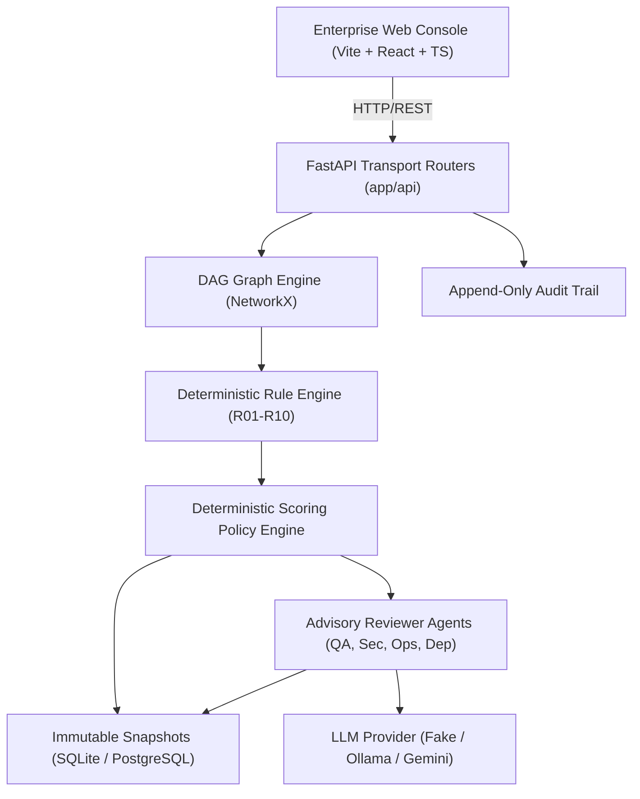

# Deploywise AI — Architecture & System Design

Deploywise AI is a predictive workflow risk detection and prevention copilot designed to review software delivery and release workflows before they execute, identify control gaps and risky dependency paths, and allow reviewers to simulate safer alternatives before deployment.

## System Components

### 1. Data Contracts & Graph Engine (`core/graph.py`, `core/schemas.py`)
- Directed Acyclic Graph (DAG) model representing delivery stages, dependencies, flags, and owners.
- Enforces strict input validation: max 256 KB JSON import, max 100 stages, unique `^[a-z0-9_-]{1,40}$` stage IDs.
- Validates acyclicity using NetworkX reachability and cycle detection algorithms.

### 2. Deterministic Rule Registry (`core/rules/`)
- Pure Python functions evaluated against the graph DAG without LLMs, network calls, or randomness.
- Ten authoritative rules:
  - **R01**: Missing Tests (High)
  - **R02**: Missing Security Scan (Critical, Blocking)
  - **R03**: Missing Approval Gate (Critical, Blocking)
  - **R04**: No Rollback Plan (High / Critical if high blast radius)
  - **R05**: Unowned Stage (Medium / High if deploy)
  - **R06**: Invalid Stage Order (High)
  - **R07**: Missing Monitoring Check (Medium)
  - **R08**: Unverified Dependency Change (High)
  - **R09**: Tests Bypassable / Skippable (High)
  - **R10**: No Staging Validation (Medium)

### 3. Scoring & Policy Engine (`core/scoring.py`, `core/policy.py`)
- Policy weights: Security (25%), Testing (25%), Recovery (20%), Dependency (15%), Governance (15%).
- Severity penalty points: Critical (50), High (30), Medium (15), Low (5), Category Cap (100).
- Any blocking finding forces `verdict = BLOCKED`. Otherwise thresholds: `HIGH_RISK` (>=60), `NEEDS_REVIEW` (>=30), `PASS` (<30).

### 4. AI Reviewer Agents (`agents/`, `llm/`)
- Four specialist advisory reviewer roles: Security, QA, Dependency, Operations.
- Strict schema parsing: rejects invalid JSON, unknown stage IDs, empty evidence, or any attempt to set `blocking=true`.
- Supports `FakeLLM`, `OllamaLLM`, and `GeminiLLM`.

### 5. What-If Simulation Engine (`services/analysis.py`)
- In-memory speculative execution applying operations (`add_stage`, `remove_stage`, etc.) to cloned graphs.
- Generates precise before/after score delta and resolved violation lists without mutating saved database records.
